<p align="center">
  
</p>

# R1K4-FB-USER-HANDER

Facebook username to UID and profile picture API, with a Telegram bot.

## Features

- Facebook username or profile link to numeric UID
- Profile picture (720x720) through the Graph API
- Telegram bot: send a username, get the UID and profile picture
- All settings in one config.json at the top of the project

## Run the API

```
pip install -r requirements.txt
python main.py
```

## Endpoints

| Endpoint | Description |
| --- | --- |
| GET /find-uid?id=USERNAME | Get the UID of a Facebook profile |
| GET /profile-pic?id=USERNAME | Get the profile picture link |
| GET /profile-pic?id=USERNAME&go=1 | Open the profile picture directly |

## Run the Telegram bot

```
python bot.py
```

Bot: @rika3bot

Send the bot a Facebook username or profile link, it replies with the UID and profile picture.

## Project structure

```
R1K4-FB-USER-HANDER/
├── config.json
├── main.py
├── bot.py
├── banner.svg
├── app/
│   ├── config.py
│   ├── facebook.py
│   └── routes.py
├── requirements.txt
└── README.md
```

## Config

All settings are in config.json:

| Key | Description |
| --- | --- |
| bot_token | Telegram bot token from BotFather |
| admin_uid | Telegram user ID of the admin |
| graph_token | Facebook app access token for profile pictures |
| host | Server host |
| port | Server port |
| author | Author name shown in API responses |

<p align="center">Author: <b>R1K4</b></p>
